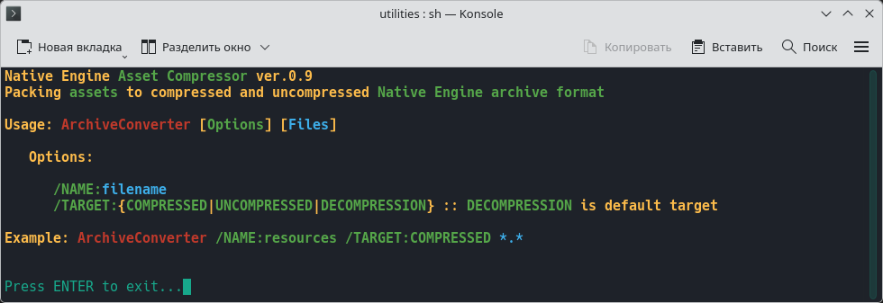

## UTILITIES

I develop my own game editors with the goal of replacing a multitude of third-party programs, utilities, and plugins with a single application. For instance, a single game-object editor can be used to highly optimize models, configure their materials, collisions, joints, and skeletons, and even generate presentation-quality renders of new models for online publication. In the same vein, I fine-tune the functionality and user interface of these editors to perfectly suit my own needs and workflow.

---

Game archive packager: A `BASH` script that compiles `Lua` scripts into `LuaC` format and packages game archives using a custom utility called `AssetCompressor`; these functions will eventually be integrated into the game world editor.

The `luac` utility is used for compiling Lua scripts, while the `glslang` utility is used for compiling `GLSL` shaders into the `SPIR-V` format.

---

### © 2017-2026 Daniil Petrov