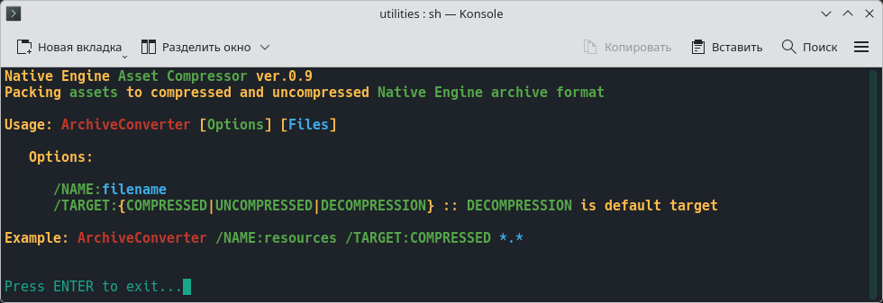

## UTILITIES • УТИЛИТЫ

I develop my own game editors with the goal of replacing a multitude of third-party programs, utilities, and plugins with a single application. For instance, a single game-object editor can be used to highly optimize models, configure their materials, collisions, joints, and skeletons, and even generate presentation-quality renders of new models for online publication. In the same vein, I fine-tune the functionality and user interface of these editors to perfectly suit my own needs and workflow.

Свои игровые редакторы я разрабатываю с целью замены одной программой множества сторонних программ, утилит и плагинов, чтобы, например, в одном редакторе игровых объектов можно было предельно оптимизировать модели, настраивать их материалы, коллизии, шарниры и скелеты, а также делать презентационные рендеры новых моделей для их публикации в интернете. Точно также я предельно оптимизирую под себя возможности и удобство интерфейса данных редакторов.

---

Game archive packager: A BASH script that compiles Lua scripts into LuaC format and packages game archives using a custom utility called `AssetCompressor`; these functions will eventually be integrated into the game world editor.

Упаковщик игровых архивов: BASH-скрипт, компилирующий Lua-скрипты в формат LuaC и упаковывающий игровые архивы самописной утилитой `AssetCompressor`, в будущем эти функции войдут в состав редактора игрового мира.

The `luac` utility is used for compiling Lua scripts, while the `glslang` utility is used for compiling GLSL shaders into the SPIR-V format.

Для компиляции Lua-скриптов используется утилита `luac`, а для компиляции GLSL-шейдеров в формат SPIR-V используется утилита `glslang`.

---

### © 2017-2026 Daniil Petrov • Даниил Петров