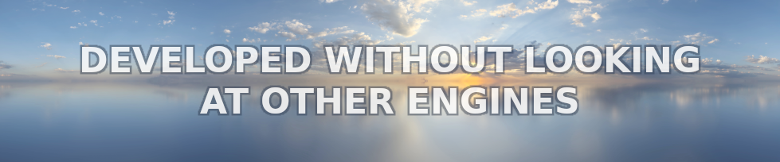

## ABOUT ME

•
[Home](README.md) •
[Tools](tools.md) •
[Utilities](utilities.md) •
[RU](ru/about-me.md)
•

---

I am a former advertising professional with experience across a wide range of multimedia — excluding CAD — and a background in the Assembly programming language. This expertise allowed me to easily transition into developing my own game-creation tools in C++, as well as various game assets. Having spent many years working on PCs, I have always been extremely selective about my professional toolkit; this is precisely why I rejected third-party game engines — which I found inadequate — and chose instead to build my own. Furthermore, having learned the simple truth that if you want to ruin a good endeavor, all you have to do is bring in bosses, investors, or partners, I have long worked on my own. I even attempted to assemble a capable team for game development at one point, but that experience only led to further disappointment; consequently, I now position myself strictly as an independent developer.

Developing game tools not only provides significant programming experience, but also allows for a deep dive into the nuances of game development—ultimately shaping one into a true professional capable of creating high-quality, highly optimized game projects. For instance, I store normal maps in the `BC6H_SF` (Signed Float) format; this eliminates the need to convert every texture texel from `Unsigned Integer` to `Signed Float` during the rendering of each frame, thereby saving precious time in the frame-rendering pipeline. Furthermore, building your own toolset grants you control over every aspect of a project’s development and visualization. While it is impossible to create a perfect set of tools right from the start, it is entirely feasible to develop a well-architected system and refine it over time.

---

### © 2017-2026 • Daniil Petrov

---

&nbsp;&nbsp;
&nbsp;&nbsp;
