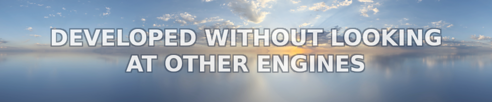

## ABOUT ME

•
[Home](README.md) •
[Tools](tools.md) •
[Utilities](utilities.md) •
About Me •
[RU](ru/about-me.md)
•

---

In the past, I was a professional in the advertising industry, working with all sorts of multimedia — with the exception of CAD — and I also studied the Assembly programming language. This background made it relatively easy for me to begin developing my own game-creation tools in C++, as well as various types of game assets. As a professional with many years of experience working on PCs, I have always been extremely selective about the tools I use; this is precisely why I rejected third-party game engines — which I found inadequate — and chose instead to build my own suite of development tools. Furthermore, having learned the simple truth that if you want to ruin a good project, all you have to do is bring in bosses, investors, or business partners, I have long worked on my own. I even tried assembling a capable team for game development at one point, but that, too, ended in disappointment — so, ultimately, I define myself strictly as an independent developer.

Developing game development tools not only provided me with significant programming experience, but also allowed me to delve deeply into the specific nuances of game creation. This process has truly shaped me into a professional game developer, capable of building high-quality, highly optimized game worlds. For instance, I store normal maps in the `BC6H_SF` (Signed Float) format; this eliminates the need to convert every texture texel from `Unsigned Integer` to `Signed Float` during frame rendering, thereby saving precious time when outputting frames to the screen. Furthermore, after evaluating various compressors — including `Zlib` and `LZ4` — I settled on `ZXC`. It offers excellent compression for game archives and significantly faster decompression speeds. Combined with parallel location loading, this ensures that players won't even notice the loading process. In just half a day, I designed a custom game archive format and built an `Asset Compressor`, and in another half-day, I developed a virtual file system to allow the engine's runtime to interact with these archives.

Having one’s own toolset makes it possible to control every aspect of a game project’s development. While it is clearly impossible to create a perfect toolset right from the start, it is entirely feasible to build a well-designed one and refine it over time. I am developing the engine’s runtime architecture entirely on my own, implementing parallelization across its various systems as I see fit. I have invested a significant amount of time and effort into selecting third-party libraries and asset formats, while also placing a strong emphasis — wherever possible — on developing my own proprietary file formats. In short, I am building this game toolset to bring my own technical solutions and ideas to life within my own PC game projects, without relying on outside advice or looking to other engines for guidance.

---

### © 2017-2026 • Daniil Petrov

---

&nbsp;&nbsp;
&nbsp;&nbsp;
