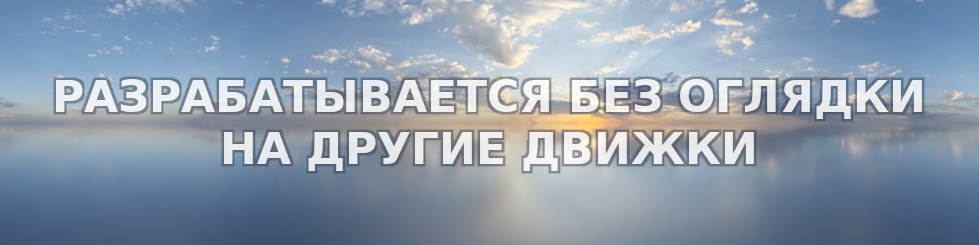

## ОБО МНЕ

•
[Главная](README.md) •
[Инструменты](tools.md) •
[Утилиты](utilities.md) •
[ENG](https://native-engine.github.io/about-me.html)
•

---

В прошлом я профессиональный рекламщик и работал со всеми видами мультимедии кроме САПР, а также изучал язык программирования Ассемблер, что без особого труда позволило мне начать осваивать разработку своего игрового инструментария на C++ и всевозможных игровых ассетов. Как профессионал с многолетним стажем работы на ПК я всегда крайне избирательно подходил к выбору своего рабочего инструментария, именно это заставило меня отказаться от сторонних игровых движков, которые я счёл непотребными, и остановить свой выбор на разработке собственного игрового инструментария. Также познав простую истину о том, что если хочешь угробить хорошее дело, нужно найти себе начальников, инвесторов или компаньонов, я давно работаю самостоятельно, а позже попробовав собрать достойную команду для разработки игр, разочаровался и в этом, в итоге позиционирую себя исключительно как независимый разработчик.

Разработка игрового инструментария окромя приобретения серьёзного опыта в программировании привлекла меня ещё и тем, что в процессе разработки досконально углубляешься в нюансы игровой разработки и становишься по истине профессиональным игровым разработчиком, способным разрабатывать очень качественные и предельно оптимизированные игровые проекты. Например, карты нормалей я сохраняю в формате `BC6H_SF (Signed Float)`, что позволяет мне при визуализации каждого кадра избегать конвертирования каждого текселя текстур моделей из формата `Unsigned Integer` в формат `Signed Float` и тем самым экономить драгоценное время вывода кадра на экран. И именно свой инструментарий позволяет контролировать каждый аспект разработки и визуализации игровых проектов, понятно, что нельзя сразу разработать идеальный инструментарий, но вполне возможно написать довольно грамотный инструментарий и постепенно доводить его до ума.

---

### © 2017-2026 • Даниил Петров

---

&nbsp;&nbsp;
&nbsp;&nbsp;
