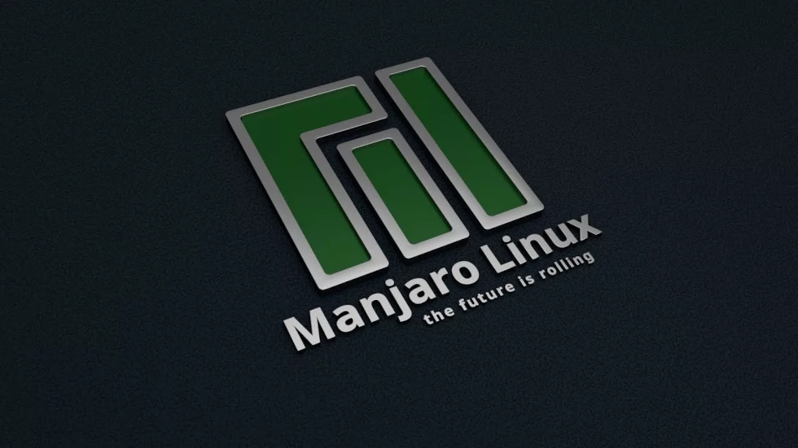
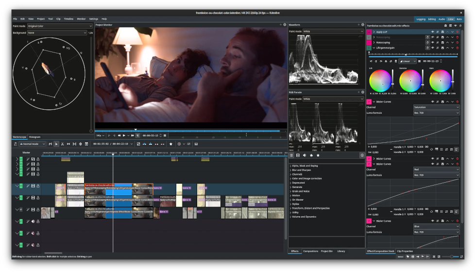
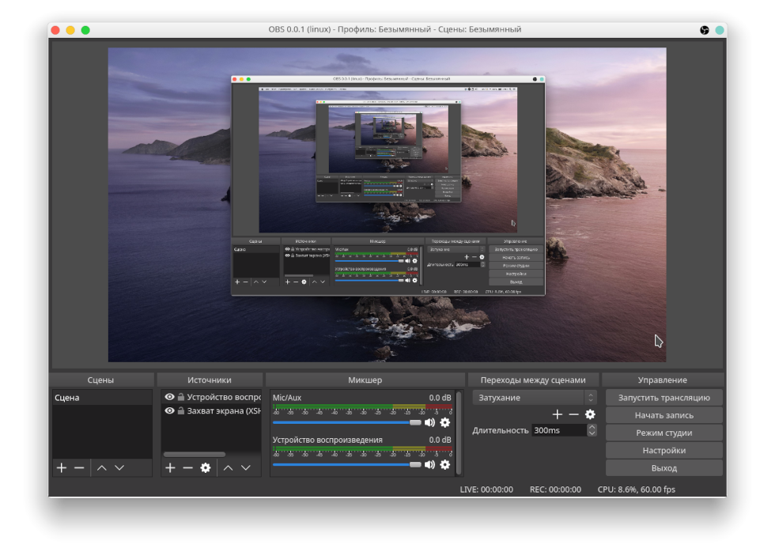

## ИСПОЛЬЗУЕМЫЙ РАБОЧИЙ ИНСТРУМЕНТАРИЙ

•
[Главная](README.md) •
[Утилиты](utilities.md) •
[Обо мне](about-me.md)
[ENG](https://native-engine.github.io/tools.html)
•

---

## ПРОГРАММНОЕ ОБЕСПЕЧЕНИЕ

* Операционная система: [Manjaro Linux](https://manjaro.org/) + [KDE Plasma](https://kde.org/plasma-desktop/)
* Веб-браузер: [Chromium](https://www.chromium.org/Home/)
* Офисный пакет: [OnlyOffice](https://www.onlyoffice.com/)
* Файловый менеджер: [Double Commander](https://doublecmd.sourceforge.io/)

---

* Растровый редактор: [GIMP](https://www.gimp.org/)
* Векторный редактор: [Inkscape](https://inkscape.org/)
* Издательская система: [Scribus](https://www.scribus.net/)
* Редактор шрифтов: [FontForge](https://fontforge.org/en-US/)

---

* 3D-графика и моушн-дизайн: [Blender](https://www.blender.org/)
* Редактор видеомонтажа: [Kdenlive](https://kdenlive.org/) *
* Звуковой редактор: [Audacity](https://www.audacityteam.org/)
* Цифровая звуковая рабочая станция: [Ardour](https://ardour.org/)

---

* Среда разработки и RAD-редактор: [Qt](https://www.qt.io/)
* Компиляторы: [GCC](https://gcc.gnu.org/) и [Crosstool-NG](https://crosstool-ng.github.io/) для актуальной и старых версий ОС Linux и [MinGW-w64](https://www.mingw-w64.org/) для ОС Windows

> [видеоредактор Davinci Resolve довольно затруднительно скачать, поддерживает далеко не все видеокарты и слишком мало поддерживаемых кодеков](https://wiki.archlinux.org/title/DaVinci_Resolve#MP4,_H.264,_H.265_and_AAC_Support)

## ВСПОМОГАТЕЛЬНЫЕ УТИЛИТЫ

* Издательство: [PDF Mix Tool](https://www.scarpetta.eu/pdfmixtool/) + [PDFsam Basic](https://pdfsam.org/) *
* Работа со шрифтами: [Font Manager](https://github.com/FontManager/font-manager) + [Gucharmap](https://github.com/GNOME/gucharmap)
* Организации референсов: [PureRef](https://www.pureref.com/)
* Написание музыки: обёртка Windows-плагинов [Yabridge](https://github.com/robbert-vdh/yabridge)
* Контейнеры для ПО: [AppImage](https://appimage.org/) для ОС Linux и [Inno Setup](https://jrsoftware.org/isdl.php) для ОС Windows

---

* Разработка: редактор шейдеров и скриптов [Kate](https://kate-editor.org/), система сборки [CMake](https://cmake.org/), кэш компиляции [Ccache](https://ccache.dev/), отладчик использования памяти [AddressSanitizer](https://github.com/google/sanitizers/wiki/AddressSanitizer), оверлей для мониторинга графики [MangoHud](https://github.com/flightlessmango/MangoHud), Windows-рантайм для Линукса [Wine](https://www.winehq.org/) и шестнадцатиричный редактор [Okteta](https://apps.kde.org/okteta/)

---

* Мультимедиа: программа для записи экрана [Open Broadcaster Software](https://obsproject.com/), аппаратный видеоконвертер [HandBrake](https://handbrake.fr/), видеопроигрыватель [MPV](https://mpv.io/) и аудиоплеер [Audacious](https://audacious-media-player.org/)

> редактор вёрстки Scribus не способен экспортировать PDF-издания с объединением двухстраничных портретных разворотов в одну альбомную страницу

## БИБЛИОТЕКИ И API

* Платформенный код для ОС Linux и Windows: [SDL](https://www.libsdl.org/)
* Графика: [Vulkan](https://vulkan.lunarg.com/sdk/home) + [OpenGL Mathematics](https://github.com/g-truc/glm)
* Звук: [OpenAL Soft](https://github.com/kcat/openal-soft) + [Ogg Vorbis](https://xiph.org/downloads/)
* Физика: [Jolt Physics](https://github.com/jrouwe/JoltPhysics)

---

* Скриптовый язык: [Lua](https://www.lua.org/download.html)
* Загрузка-сохранение настроек: [inifile-cpp](https://github.com/Rookfighter/inifile-cpp)
* Компрессия игровых архивов: [ZXC](https://libzxc.org/)

---

* Импорт-экспорт и оптимизация моделей: [cglTF](https://github.com/jkuhlmann/cgltf) + [Draco mesh](https://github.com/google/draco) + [Mesh optimizer](https://github.com/zeux/meshoptimizer)
* Импорт-экспорт изображений: [stb](https://github.com/nothings/stb) (JPEG, PNG, BMP, TGA, GIF, PSD, HDR, PIC и PNM)
* Блочная компрессия текстурных карт: [NVIDIA Texture Tools SDK](https://developer.nvidia.com/gpu-accelerated-texture-compression)

---

### © 2017-2026 • Даниил Петров

---

&nbsp;&nbsp;
&nbsp;&nbsp;

