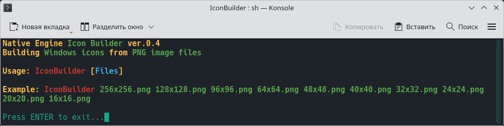
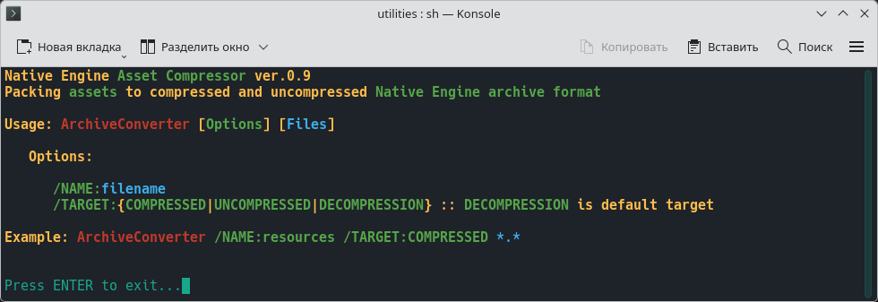

## УТИЛИТЫ

•
[Home](README.md) •
[Tools](tools.md) •
[ENG](https://native-engine.github.io/utilities.html) •
[BlueSky](https://bsky.app/profile/native-engine.bsky.social) •
[YouTube](https://www.youtube.com/@native-engine)
•

---

Свои игровые редакторы я разрабатываю с целью замены одной программой множества сторонних программ, утилит и плагинов, чтобы, например, в одном редакторе игровых объектов можно было предельно оптимизировать модели, настраивать их материалы, коллизии, шарниры и скелеты, а также делать презентационные рендеры новых моделей для их публикации в интернете. Даже для сборки Windows-иконок я использую самописную утилиту, которая собирает их из набора PNG-файлов Linux-иконки. Точно также я предельно оптимизирую под себя возможности и удобство интерфейса данных редакторов.

---

Упаковщик игровых архивов: `BASH` скрипт, компилирующий `Lua` скрипты в формат `LuaC` и упаковывающий игровые архивы самописной утилитой `AssetCompressor`, в будущем эти функции войдут в состав редактора игрового мира.

Для компиляции Lua-скриптов используется утилита `luac`, а для компиляции `GLSL` шейдеров в формат `SPIR-V` используется утилита `glslang`.

---

### © 2017-2026 • Даниил Петров