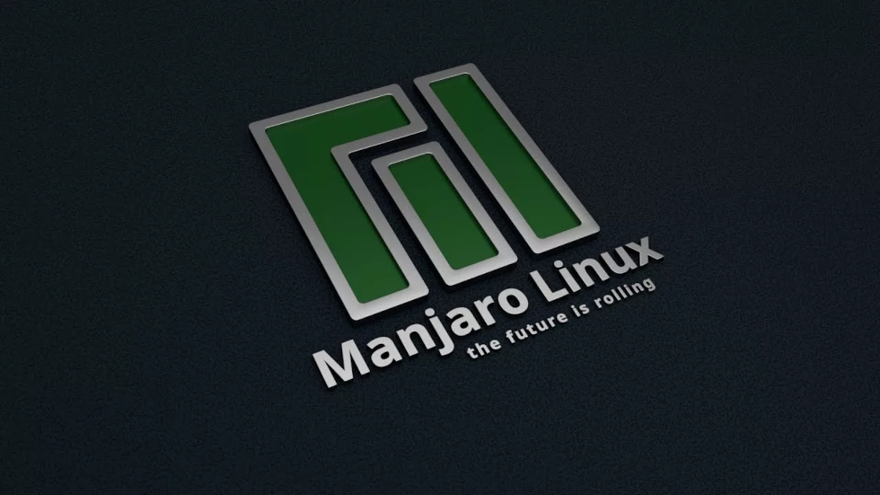
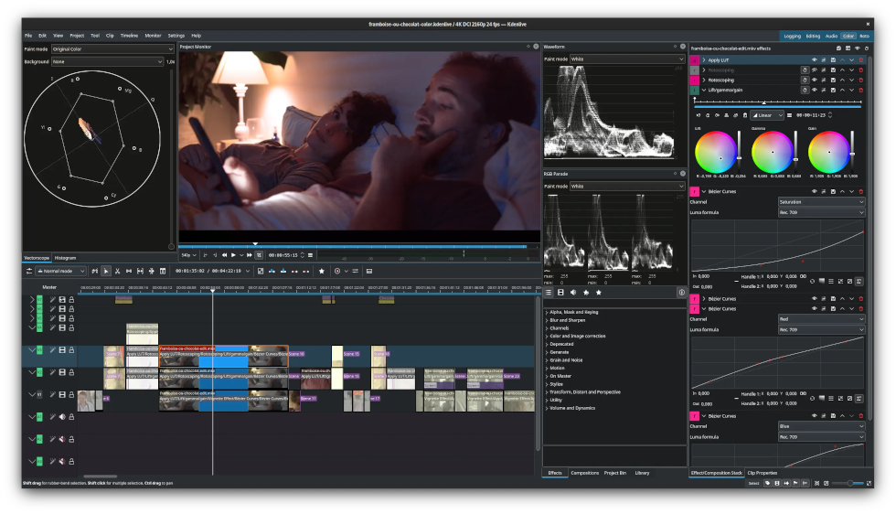
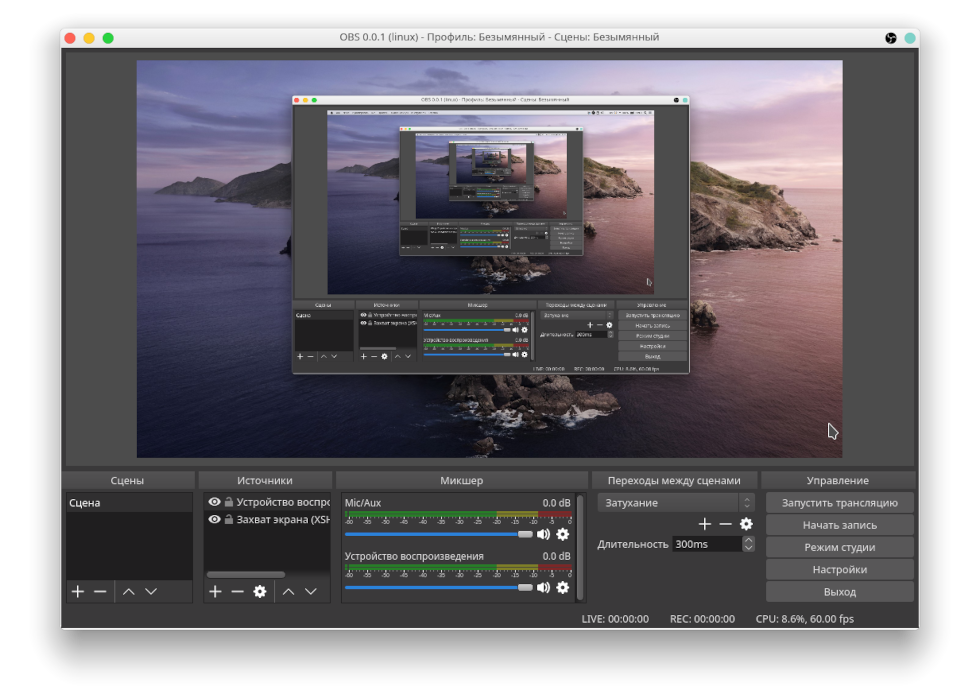

## TOOLS AND INSTRUMENTS USED

•
[Home](README.md) •
[Utilities](utilities.md) •
[About Me](about-me.md)
[RU](ru/tools.md)
•

---

## SOFTWARE

* Operating system: [Manjaro Linux](https://manjaro.org/) + [KDE Plasma](https://kde.org/plasma-desktop/)
* Web browser: [Chromium](https://www.chromium.org/Home/)
* Office suite: [OnlyOffice](https://www.onlyoffice.com/)
* File manager: [Double Commander](https://doublecmd.sourceforge.io/)

---

* Raster editor: [GIMP](https://www.gimp.org/)
* Vector editor: [Inkscape](https://inkscape.org/)
* Publishing system: [Scribus](https://www.scribus.net/)
* Font editor: [FontForge](https://fontforge.org/en-US/)

---

* 3D Graphics and Motion Design: [Blender](https://www.blender.org/)
* Video Editor: [Kdenlive](https://kdenlive.org/) *
* Audio editor: [Audacity](https://www.audacityteam.org/)
* Digital Audio Workstation: [Ardour](https://ardour.org/)

---

* Development environment and RAD editor: [Qt](https://www.qt.io/)
* Compilers: [GCC](https://gcc.gnu.org/) and [Crosstool-NG](https://crosstool-ng.github.io/) for current and older versions of the Linux OS, and [MinGW-w64](https://www.mingw-w64.org/) for the Windows OS

> [the DaVinci Resolve video editor is quite difficult to download, it does not support many graphics cards, and it has a very limited number of supported codecs](https://wiki.archlinux.org/title/DaVinci_Resolve#MP4,_H.264,_H.265_and_AAC_Support)

## AUXILIARY UTILITIES

* Publishing: [PDF Mix Tool](https://www.scarpetta.eu/pdfmixtool/) + [PDFsam Basic](https://pdfsam.org/) *
* Working with fonts: [Font Manager](https://github.com/FontManager/font-manager) + [Gucharmap](https://github.com/GNOME/gucharmap)
* Organization of references: [PureRef](https://www.pureref.com/)
* Music composition: Windows plugins wrapper [Yabridge](https://github.com/robbert-vdh/yabridge)
* Software containers: [AppImage](https://appimage.org/) for Linux and [Inno Setup](https://jrsoftware.org/isdl.php) for Windows

---

* Development: [Kate](https://kate-editor.org/) shader and script editor, [CMake](https://cmake.org/) build system, [Ccache](https://ccache.dev/) compilation cache, [AddressSanitizer](https://github.com/google/sanitizers/wiki/AddressSanitizer) memory usage debugger, [MangoHud](https://github.com/flightlessmango/MangoHud) graphics monitoring overlay, [Wine](https://www.winehq.org/) Windows runtime for Linux, and [Okteta](https://apps.kde.org/okteta/) hex editor

---

* Multimedia: [Open Broadcaster Software](https://obsproject.com/) screen recording program, [HandBrake](https://handbrake.fr/) video converter, [MPV](https://mpv.io/) video player, and [Audacious](https://audacious-media-player.org/) audio player

> the Scribus page layout editor is unable to export PDF publications by combining two-page portrait spreads into a single landscape-oriented page

## LIBRARIES AND APIs

* Platform-specific code for Linux and Windows OS: [SDL](https://www.libsdl.org/)
* Graphics: [Vulkan](https://vulkan.lunarg.com/sdk/home) + [OpenGL Mathematics](https://github.com/g-truc/glm)
* Sound: [OpenAL Soft](https://github.com/kcat/openal-soft) + [Ogg Vorbis](https://xiph.org/downloads/)
* Physics: [Jolt Physics](https://github.com/jrouwe/JoltPhysics)

---

* Scripting language: [Lua](https://www.lua.org/download.html)
* Loading / saving settings: [inifile-cpp](https://github.com/Rookfighter/inifile-cpp)
* Compression of game archives: [ZXC](https://libzxc.org/)

---

* Import-export and model optimization: [cglTF](https://github.com/jkuhlmann/cgltf) + [Draco mesh](https://github.com/google/draco) + [Mesh optimizer](https://github.com/zeux/meshoptimizer)
* Image import and export: [stb](https://github.com/nothings/stb) (JPEG, PNG, BMP, TGA, GIF, PSD, HDR, PIC и PNM)
* Block-based texture map compression: [NVIDIA Texture Tools SDK](https://developer.nvidia.com/gpu-accelerated-texture-compression)

---

### © 2017-2026 • Daniil Petrov

---

&nbsp;&nbsp;
&nbsp;&nbsp;

