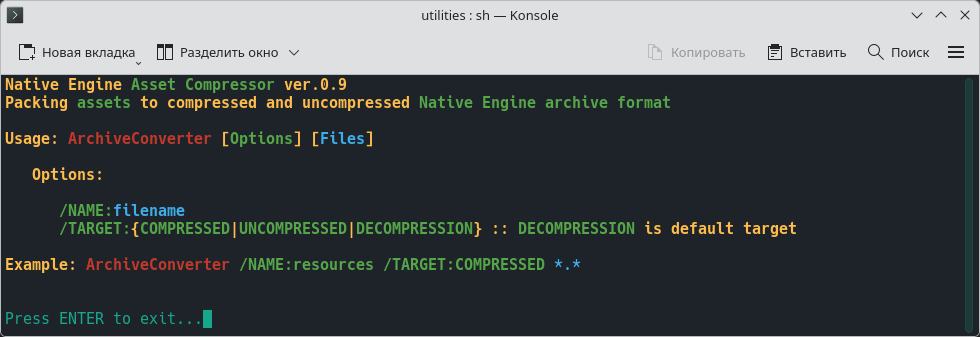

## UTILITIES

•
[Home](README.md) •
[Tools](tools.md) •
[About Me](about-me.md)
[RU](ru/utilities.md) •
•

---

I develop my own game editors with the goal of replacing a multitude of third-party programs, utilities, and plugins with a single application. For instance, a single game-object editor can handle everything from highly optimizing models and configuring their materials, collisions, joints, and skeletons, to generating presentation-quality renders for online publication. I even use a custom-built utility to assemble Windows icons from a collection of PNG files originally intended for Linux. In the same vein, I fine-tune the functionality and user interface of these editors to perfectly suit my own workflow and preferences.

---

Game archive packager: A `BASH` script that compiles `Lua` scripts into `LuaC` format and packs game archives using a custom-built utility called `AssetCompressor`; in the future, these functions will be integrated into the game world editor.

The `luac` utility is used for compiling Lua scripts, while the `glslang` utility is used for compiling `GLSL` shaders into the `SPIR-V` format.

---

### © 2017-2026 • Daniil Petrov

---

&nbsp;&nbsp;
&nbsp;&nbsp;
